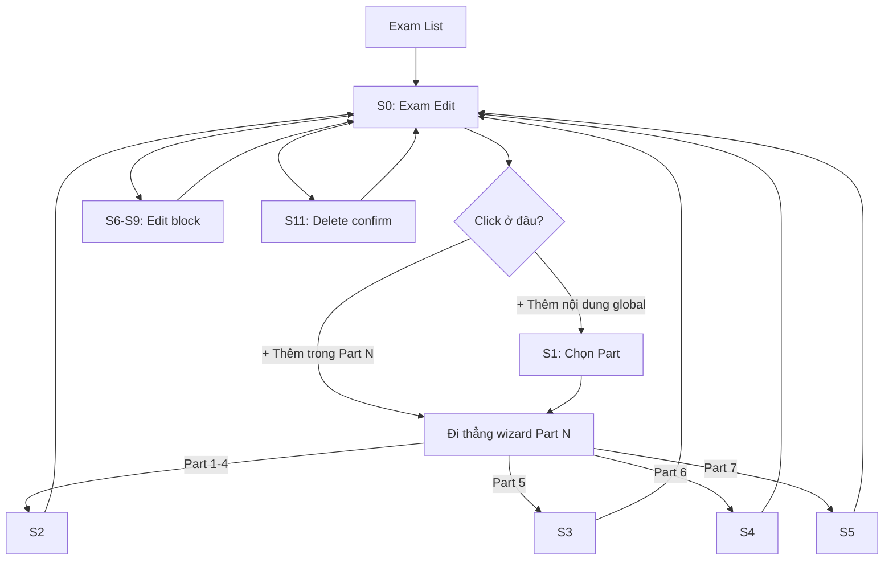

# Đặc tả màn hình CMS — Tạo & quản lý câu hỏi TOEIC (AcadPrep)

Tài liệu mô tả **screens, user flow, fields và validation** để AI/designer implement giao diện CMS cho Moderator.

**Phạm vi:** UC-16.4 (Update Exam), UC-17.x (Question CRUD), UC-18.x (Passage CRUD)  
**Đối tượng:** Moderator / Admin  
**Entry point chính:** Exam Edit (`/Admin/Exams/Edit?id={examId}`)

---

**Liên quan:**
- [Question_Content_API_Contract.md](./Question_Content_API_Contract.md) — API composite lưu từng block theo Part
- [Stitch_Question_Content_Design_Prompts.md](./Stitch_Question_Content_Design_Prompts.md) — prompt paste vào Google Stitch

---

## 1. Nguyên tắc thiết kế

| Nguyên tắc | Mô tả |
|---|---|
| **Context-first** | Câu hỏi luôn thuộc một **Exam** (`ExamId` bắt buộc). Entry chính từ **Exam Edit**. |
| **Part-driven UI** | Mỗi Part có form/wizard riêng — không dùng một form chung cho 7 Part. |
| **Wizard cho nhóm** | Part 1–4, 6, 7 tạo theo **nhóm/set** (nhiều câu + media/passage). Part 5 tạo **từng câu lẻ**. |
| **Preview** | Mọi màn tạo/sửa đều có **preview** giống giao diện thí sinh làm bài. |
| **Validation inline** | Lỗi hiện ngay dưới field; có summary lỗi trước khi Save. |
| **Contextual navigation** | Bấm "Thêm" **trong một Part** → đi thẳng wizard/form Part đó, **không** hỏi lại Part. |

---

## 2. Mô hình dữ liệu (tham chiếu entity)

### QuestionGroup
Dùng cho **Part 1–4** (Listening) và **Part 7** (Reading Set).

| Field | Mô tả |
|---|---|
| `Name` | Tên nhóm / set |
| `AudioUrl` | File audio riêng (Part 2–4) |
| `AudioStartSecond` / `AudioEndSecond` | Mốc trên file audio full của Exam |
| `ImageUrl` | Ảnh chung (Part 1) |
| `ExamId` | Đề thi |

### Passage
Dùng cho **Part 6** (1 passage → n câu) và **Part 7** (1–3 passage trong một Reading Set).

| Field | Mô tả |
|---|---|
| `Content` | Nội dung text (Part 6: có marker blank `(131)`) |
| `ImageUrl` | Ảnh đoạn văn |
| `DisplayOrder` | Thứ tự hiển thị (1, 2, 3) — Part 7 |
| `QuestionGroupId` | **Bắt buộc Part 7**, **NULL Part 6** |
| `ExamId` | Đề thi |

### Question

| Field | Mô tả |
|---|---|
| `QuestionNumber` | Số câu trong đề (unique per exam) |
| `Part` | 1–7 |
| `QuestionText` | Nội dung câu hỏi |
| `AudioUrl` / `ImageUrl` | Media riêng từng câu (nếu cần) |
| `AudioStartSecond` / `AudioEndSecond` | Mốc audio |
| `CorrectOption` | A / B / C / D |
| `ExamId` | Đề thi |
| `PassageId` | **Part 6: bắt buộc** · Part 7: optional |
| `QuestionGroupId` | **Part 1–4, 7: bắt buộc** · Part 5–6: NULL |
| `QuestionType` / `TopicTag` | Metadata tùy chọn |
| `QuestionOptions` | 4 lựa chọn A, B, C, D |

### Liên kết theo Part

| Part | Cấu trúc | Liên kết |
|---|---|---|
| **1–4** | QuestionGroup → n Questions | `Question.QuestionGroupId` |
| **5** | Question đơn lẻ | Không group, không passage |
| **6** | 1 Passage → 4 Questions | `Question.PassageId` |
| **7** | QuestionGroup → 1–3 Passages → 2–5 Questions | `Passage.QuestionGroupId` + `Question.QuestionGroupId` |

---

## 3. Danh sách màn hình

| ID | Screen | Mục đích | UC |
|---|---|---|---|
| **S0** | Exam Edit (hub) | Quản lý câu hỏi theo Part | UC-16.4 |
| **S1** | Chọn Part (modal, **tùy chọn**) | Chỉ khi thêm từ nút global, chưa biết Part | — |
| **S2** | Tạo Listening Group | Part 1–4 | UC-17.2 |
| **S3** | Tạo câu đơn Part 5 | 1 câu standalone | UC-17.2 |
| **S4** | Tạo Text Completion Set | Part 6 | UC-17.2, UC-18.2 |
| **S5** | Tạo Reading Set | Part 7 | UC-17.2, UC-18.2 |
| **S6** | Sửa câu hỏi đơn | Edit 1 Question | UC-17.4 |
| **S7** | Sửa Listening Group | Edit QuestionGroup P1–4 | UC-17.4 |
| **S8** | Sửa Reading Set | Edit QuestionGroup + Passages P7 | UC-17.4, UC-18.4 |
| **S9** | Sửa Text Completion Set | Edit Passage + Questions P6 | UC-17.4, UC-18.4 |
| **S10** | Question Bank (phase 2) | Danh sách toàn bộ câu | UC-17.1, 17.6, 17.7 |
| **S11** | Xác nhận xóa (modal) | Delete question/group/set | UC-17.5, UC-18.5 |

**MVP tối thiểu:** S0 → (S2 \| S3 \| S4 \| S5) trực tiếp theo Part · S1 chỉ khi add global · S6 + S11

---

## 4. User flow



### Flow theo Part (đường chính — từ nút trong accordion)

```
Part 1-4:  S0 [Part N] → S2 (3 bước) → Save → S0
Part 5:    S0 [Part 5] → S3 (1 trang) → Save → S0
Part 6:    S0 [Part 6] → S4 (2 bước) → Save → S0
Part 7:    S0 [Part 7] → S5 (3 bước) → Save → S0
```

### Flow phụ — add global (chưa biết Part)

```
S0 [header: + Thêm nội dung] → S1 (chọn Part) → S2/S3/S4/S5 → Save → S0
```

### Ánh xạ Part → Screen

| Part | Nút trên S0 | Đích |
|---|---|---|
| 1–4 | `+ Thêm nhóm nghe` | S2 `?part={n}` |
| 5 | `+ Thêm câu` | S3 |
| 6 | `+ Thêm đoạn văn` | S4 |
| 7 | `+ Thêm reading set` | S5 |

---

## 5. Mô tả chi tiết từng screen

### S0 — Exam Edit (Question Management Hub)

**Route:** `/Admin/Exams/Edit?id={examId}`  
**Layout:** `_ModeratorLayout`

**Thành phần UI:**

1. **Header**
   - Back → Exam List
   - Exam title, ID, duration
   - Nút "View Details" → `/Admin/Exams/Detail?id={examId}`

2. **Progress bar cấu trúc đề**
   - 7 segment Part 1 → 7
   - Mỗi segment: `X/Y câu` (Y chuẩn TOEIC: P1=6, P2=25, P3=39, P4=30, P5=30, P6=16, P7=54)

3. **7 accordion/tab theo Part**
   - Mỗi Part: danh sách block + nút thêm **theo ngữ cảnh Part** (đi thẳng S2–S5, **bỏ qua S1**)
   - Label nút theo Part (xem bảng dưới)
   - Empty state: illustration + "Chưa có câu hỏi" + CTA cùng label

4. **Nút global (optional)** — header exam
   - `+ Thêm nội dung` → mở **S1** (chỉ khi moderator chưa biết thêm Part nào)

**Nút "Thêm" theo từng Part (trên S0):**

| Part | Label nút | Navigate |
|---|---|---|
| 1–4 | `+ Thêm nhóm nghe` | S2 `?part={n}` |
| 5 | `+ Thêm câu` | S3 |
| 6 | `+ Thêm đoạn văn` | S4 |
| 7 | `+ Thêm reading set` | S5 |

**Card item theo Part:**

| Part | Nội dung card |
|---|---|
| 1–4 | `Group: Photographs #1` · 6 câu · icon audio/ảnh · Edit · Delete |
| 5 | `Q101: The report ___ submitted...` · Edit · Delete |
| 6 | `Passage #3 · 4 chỗ trống (131–134)` · Edit · Delete |
| 7 | `Reading Set #5 · 2 đoạn văn · 5 câu` · Edit · Delete |

**Actions:**
- Edit → S6 / S7 / S8 / S9 (tùy loại block)
- Delete → S11
- Reorder (drag) — optional phase 2

---

### S1 — Chọn Part (Modal, **chỉ khi add global**)

**Trigger:** Nút `+ Thêm nội dung` ở **header S0** (không gắn Part cụ thể).  
**Không dùng S1** khi user bấm nút thêm **bên trong accordion Part N** — đi thẳng S2/S3/S4/S5.

**Kích thước:** Modal medium (~600px)

**Nội dung:**

- Title: `Thêm nội dung vào [Tên đề thi]`
- Subtitle: `Chọn Part bạn muốn thêm`
- 7 card chọn Part:

| Part | Label | Mô tả | Số câu chuẩn | Next |
|---|---|---|---|---|
| 1 | Photographs | 1 ảnh + nhiều câu mô tả ảnh | 6 | S2 |
| 2 | Question-Response | 1 audio + câu hỏi–đáp | 25 | S2 |
| 3 | Conversations | 1 hội thoại + 3 câu/set | 39 | S2 |
| 4 | Talks | 1 bài nói + 3 câu/set | 30 | S2 |
| 5 | Incomplete Sentences | Câu đơn, điền từ | 30 | S3 |
| 6 | Text Completion | 1 đoạn văn + 4 chỗ trống | 16 | S4 |
| 7 | Reading Comprehension | 1–3 đoạn + 2–5 câu/set | 54 | S5 |

- Mỗi card: icon, tên Part, mô tả 1 dòng, badge tiến độ `12/25` (optional)
- Footer: Hủy

---

### S2 — Tạo Listening Group (Part 1–4)

**Route:** `/Admin/Exams/{examId}/Questions/Create/Listening?part={1-4}`  
**Layout:** Wizard 3 bước + stepper + preview panel (desktop: 2 cột)

#### Bước 1/3 — Group & Media

| Field | Type | Required | Ghi chú |
|---|---|---|---|
| Part | Badge read-only | — | Từ context S0 (query `part` hoặc accordion) |
| Tên nhóm | Text | ✓ | VD: `Part 3 - Conversation 1` |
| Loại media | Radio | ✓ | `Ảnh` (P1) / `Audio` (P2–4) / `Cả hai` |
| Upload ảnh | File + URL | P1: ✓ | Preview thumbnail |
| Nguồn audio | Radio | P2–4: ✓ | `Upload file` / `Dùng audio full của đề` |
| File audio | Upload | Conditional | MP3, max 10MB |
| Bắt đầu (giây) | Number | Conditional | Khi dùng audio full |
| Kết thúc (giây) | Number | Conditional | |
| Audio preview | Player | — | Play/pause |

#### Bước 2/3 — Questions

Repeater thêm/xóa câu (gợi ý số lượng: P1=6, P2≈5/set, P3/P4≈3/set).

**Mỗi câu:**

| Field | Type | Required |
|---|---|---|
| Số câu | Number | ✓ (auto-suggest next) |
| Nội dung câu | Textarea | Optional P1/P2 |
| Ảnh (per Q) | Upload | Optional |
| Đáp án A–D | Text ×4 | ✓ |
| Đáp án đúng | Radio A/B/C/D | ✓ |
| Topic tag | Tag input | Optional |

**Preview:** Ảnh/audio + câu đang chọn (giống màn thi).

#### Bước 3/3 — Review & Save

- Summary: thông tin group + danh sách câu + đáp án đúng (highlight)
- Danh sách lỗi validation
- Nút: Quay lại · **Lưu nhóm**

---

### S3 — Tạo câu đơn Part 5

**Route:** `/Admin/Exams/{examId}/Questions/Create/Part5`  
**Layout:** Single page, form trái + preview phải

| Field | Type | Required |
|---|---|---|
| Số câu | Number | ✓ |
| Nội dung câu | Textarea | ✓ (có chỗ trống `___`) |
| Đáp án A–D | Text ×4 | ✓ |
| Đáp án đúng | Radio | ✓ |
| Loại câu | Dropdown | Optional |
| Topic tag | Tag input | Optional |

**Actions:** Hủy · Lưu · Lưu & thêm câu tiếp

---

### S4 — Tạo Text Completion Set (Part 6)

**Route:** `/Admin/Exams/{examId}/Questions/Create/Part6`  
**Layout:** Wizard 2 bước

#### Bước 1/2 — Passage

| Field | Type | Required |
|---|---|---|
| Loại đoạn văn | Radio | ✓ | `Text` / `Ảnh` / `Cả hai` |
| Nội dung | Textarea | Text: ✓ | Marker blank: `(131)`, `(132)`... |
| Helper chèn blank | Button chips | — | Insert `(___)` + auto-number |
| Upload ảnh | File | Ảnh: ✓ | |
| Preview | Panel | — | Highlight blanks theo màu |

#### Bước 2/2 — Questions (4 câu)

- Auto-detect số blank từ marker → sinh 4 card câu
- Mỗi câu:

| Field | Type | Required |
|---|---|---|
| Số câu | Number | ✓ (khớp marker) |
| Nội dung câu | Text | Optional |
| Đáp án A–D | Text ×4 | ✓ |
| Đáp án đúng | Radio | ✓ |

**Preview:** Passage full width, 4 câu bên dưới.

**Actions:** Quay lại · **Lưu bộ Part 6**

---

### S5 — Tạo Reading Set (Part 7)

**Route:** `/Admin/Exams/{examId}/Questions/Create/Part7`  
**Layout:** Wizard 3 bước

#### Bước 1/3 — Thông tin set

| Field | Type | Required |
|---|---|---|
| Tên set | Text | ✓ | VD: `Set 5 - Double passage` |
| Số đoạn văn | Segmented 1 / 2 / 3 | ✓ | |

#### Bước 2/3 — Passages (tab 1–3)

**Mỗi passage:**

| Field | Type | Required |
|---|---|---|
| Thứ tự | Read-only 1, 2, 3 | ✓ |
| Loại | Radio Text / Ảnh / Cả hai | ✓ |
| Nội dung | Textarea | Conditional |
| Ảnh | Upload | Conditional |

**Preview:** Các đoạn xếp dọc như màn thi.

#### Bước 3/3 — Questions (2–5 câu)

| Field | Type | Required |
|---|---|---|
| Thêm câu | Button | Max 5 |
| Số câu | Number | ✓ |
| Nội dung câu | Textarea | ✓ |
| Đáp án A–D | Text ×4 | ✓ |
| Đáp án đúng | Radio | ✓ |
| Liên kết passage | Dropdown | Optional | `Cả set` / Passage 1 / 2 / 3 |

**Actions:** Quay lại · **Lưu Reading Set**

---

### S6 — Sửa câu hỏi đơn

**Route:** `/Admin/Exams/{examId}/Questions/{questionId}/Edit`  
**Dùng cho:** Part 5, hoặc sửa 1 câu trong group/set

**Fields:** Giống S3 + read-only Part, link Group/Passage (nếu có)  
**Actions:** Lưu · Hủy · Xóa (→ S11)

---

### S7 — Sửa Listening Group (Part 1–4)

**Route:** `/Admin/Exams/{examId}/Groups/{groupId}/Edit`  
**Layout:** 2 cột — trái: media group · phải: danh sách câu (collapse)

**Actions:** Lưu · Thêm câu · Xóa nhóm (→ S11)

---

### S8 — Sửa Reading Set (Part 7)

**Route:** `/Admin/Exams/{examId}/ReadingSets/{groupId}/Edit`  
**Layout:** 3 section accordion

1. Thông tin set  
2. Passages (drag reorder)  
3. Questions  

**Actions:** Lưu · Xóa set (→ S11, kèm passages + câu)

---

### S9 — Sửa Text Completion Set (Part 6)

**Route:** `/Admin/Exams/{examId}/Passages/{passageId}/Edit`  
**Layout:** Passage editor trên · 4 câu bên dưới

**Actions:** Lưu · Xóa passage (→ S11, kèm 4 câu)

---

### S10 — Question Bank (Phase 2)

**Route:** `/Admin/Questions`

**Table:** Số câu · Part · Exam · Preview text · Tags · Actions  
**Filter:** Part · Exam · Topic tag · Search  
**Actions:** Xem · Sửa · Xóa

---

### S11 — Xác nhận xóa (Modal)

**Variants:**

| Loại xóa | Ảnh hưởng |
|---|---|
| 1 câu | Chỉ question |
| Listening group | QuestionGroup + tất cả questions |
| Passage Part 6 | Passage + 4 questions |
| Reading set Part 7 | QuestionGroup + passages + questions |

**UI:**
- Warning đỏ
- Liệt kê items bị xóa
- Nếu đề đã có lượt thi: yêu cầu gõ `DELETE` để xác nhận
- Nút: Hủy · Xác nhận xóa

---

## 6. Shared components (thiết kế 1 lần, tái sử dụng)

| Component | Mô tả |
|---|---|
| `QuestionOptionsEditor` | 4 input A–D + radio chọn đáp án đúng |
| `MediaUploader` | Drag-drop file, URL fallback, preview |
| `AudioTimeRangePicker` | Start/end second + mini player |
| `BlankMarkerEditor` | Textarea + nút chèn `(131)` + highlight preview |
| `PassagePreview` | Render text/ảnh giống learner UI |
| `QuestionPreview` | Mock exam question card |
| `PartProgressChip` | `Part 3 · 12/39 câu` |
| `ValidationSummary` | Danh sách lỗi trước submit |
| `WizardStepper` | Step 1/3, 2/3, 3/3 |

---

## 7. Validation rules

| Part | Rule |
|---|---|
| **Tất cả** | `QuestionNumber` unique trong exam · Part 1–7 · đủ 4 options · 1 correct |
| **1–4** | `QuestionGroupId` required · audio hoặc image required trên group |
| **5** | Không `PassageId` · không `QuestionGroupId` |
| **6** | `PassageId` required · 4 câu/passage · marker khớp số câu · `Content` hoặc `ImageUrl` |
| **7** | `QuestionGroupId` required · 1–3 passages · 2–5 câu · mỗi passage có `Content` hoặc `ImageUrl` |

**Part 7 constants (code):**
- Passages: 1–3
- Questions: 2–5
- `DisplayOrder` unique trong cùng set

**Part 6 convention:**
- Marker blank trong `Passage.Content`: `(131)`, `(132)`, ...
- Mỗi marker = 1 question với `QuestionNumber` tương ứng

---

## 8. Ví dụ dữ liệu

### Part 6 — 1 đoạn + 4 câu

```
Passage {
  Content: "The meeting will be held on (131) at the main office...",
  ImageUrl: null,
  QuestionGroupId: null
}
Question { Part=6, PassageId=1, QuestionNumber=131, ... }
Question { Part=6, PassageId=1, QuestionNumber=132, ... }
...
```

### Part 7 — 2 đoạn + 5 câu

```
QuestionGroup { Name: "Set-05" }
Passage { QuestionGroupId=10, DisplayOrder=1, Content="Dear Mr. Lee..." }
Passage { QuestionGroupId=10, DisplayOrder=2, ImageUrl="/forms/job-app.png" }
Question { Part=7, QuestionGroupId=10, PassageId=null, QuestionNumber=165 }
...
Question { Part=7, QuestionGroupId=10, PassageId=null, QuestionNumber=169 }
```

---

## 9. Thứ tự implement gợi ý

1. S0 — hub với nút thêm theo Part (direct navigation)  
2. S3 — Part 5 (đơn giản nhất)  
3. S4 — Part 6  
4. S2 — Part 1–4  
5. S5 — Part 7  
6. S1 — modal add global (optional, sau khi direct flow ổn)  
7. S6–S9 + S11 — edit & delete  
8. S10 — Question Bank (phase 2)

---

## 10. Prompt cho AI design UI

```
Design a CMS for TOEIC exam content management (AcadPrep Moderator panel).

Style: Material Design 3, clean admin dashboard, light theme, primary blue,
sidebar navigation (_ModeratorLayout), desktop-first (1280px), responsive tablet.

Screens to design:
1. Exam Edit hub (S0) — 7 Part accordions, per-Part add buttons (direct to wizard, NO re-select Part),
   optional global "+ Thêm nội dung" in header
2. Modal (S1, optional) — choose Part 1-7 ONLY for global add from header
3. Wizard (S2) — Listening Group Part 1-4: 3 steps — media upload, questions repeater, review
4. Form (S3) — Part 5 single question with 4 options
5. Wizard (S4) — Part 6 text completion: passage with blank markers (131) + 4 fill-in questions
6. Wizard (S5) — Part 7 reading set: 1-3 passages (text/image) + 2-5 comprehension questions
7. Edit screens (S6-S9) — inline edit for each block type
8. Delete confirm modal (S11)
9. Shared: QuestionOptionsEditor, MediaUploader, live preview panel

UX rule: clicking "+ Thêm" inside Part 6 accordion goes directly to S4 wizard — skip S1.

Each create flow has a live preview panel showing learner exam view.
Use stepper for wizards, inline validation, empty states, loading skeletons.
Language: Vietnamese labels, English Part names (Part 1: Photographs, etc.)
Reference existing pages: Admin/Exams/Edit.cshtml, Admin/Exams/Detail.cshtml
```

---

## 11. Routes tổng hợp

| Screen | Route |
|---|---|
| S0 | `/Admin/Exams/Edit?id={examId}` |
| S1 | Modal on S0 **header only** (global add) |
| S2 | `/Admin/Exams/{examId}/Questions/Create/Listening?part={1-4}` |
| S3 | `/Admin/Exams/{examId}/Questions/Create/Part5` |
| S4 | `/Admin/Exams/{examId}/Questions/Create/Part6` |
| S5 | `/Admin/Exams/{examId}/Questions/Create/Part7` |
| S6 | `/Admin/Exams/{examId}/Questions/{questionId}/Edit` |
| S7 | `/Admin/Exams/{examId}/Groups/{groupId}/Edit` |
| S8 | `/Admin/Exams/{examId}/ReadingSets/{groupId}/Edit` |
| S9 | `/Admin/Exams/{examId}/Passages/{passageId}/Edit` |
| S10 | `/Admin/Questions` |
| S11 | Modal |
